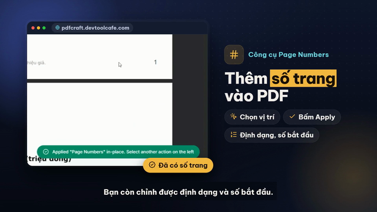
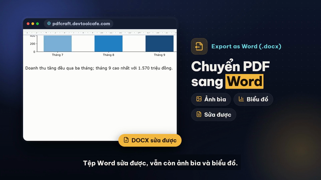

# Spike P1-06: renderer v2 (template HTML/CSS + HyperFrames + FFmpeg)

Issue **#80** (Refs #67). Prompt: `docs/prompts/be-p1-render-template-v2.md`.
Branch `spike/p1-render-v2`, tạo từ `spike/p1-render` (#77, chưa merge).

**Mục đích: lấy số đo cho buổi chốt công nghệ.** Đây chưa phải triển khai, và cũng không ép BE dùng HyperFrames.
Phạm vi: 1 preset ("điện ảnh tối giản") × 5 bố cục (`hook`, `stat`, `feature_clip`, `claim`, `cta`) × 2 tỉ lệ.
`claim` (chỉ có chữ, hiện claim nguyên văn) thêm sau, cho cảnh M2 không có `stat_display` (Refs P1-08).
Đầu vào là video mẫu PDFCraft **40–45 s**. Làm 16:9 trước, 9:16 sau.

## Kết quả ngắn

| | |
|---|---|
| Video | `D:\Code\AI-Content-Review\demo-out\v2\pdfcraft-40-45s-16x9-run1.mp4`, `…-9x16-run1.mp4` (**42,10 s**, 7 cảnh, 16 câu VieNeu) |
| Dựng hình | HyperFrames 0.8.173 (Apache-2.0): Chrome headless tua từng khung → MP4 không tiếng. Không crash trên máy worker |
| Ghép | FFmpeg: đặt voice đúng mốc + đốt phụ đề ASS (cách của #77) |
| Thời gian | Khoảng **3 phút cho mỗi tỉ lệ** (169–174 s), chậm hơn renderer FFmpeg #77 (48,8 s) khoảng 3,6 lần. Xem [Số đo](#số-đo-máy-worker) |
| RAM đỉnh | khoảng 2,5–2,9 GB (node + các tiến trình Chrome), vẽ phần mềm khoảng 4,3 GB; #77 khoảng 1,9 GB |
| Tất định | **Chưa đạt**: 2 lần render khác nhau rất nhỏ (PSNR ≥ 44,7 dB) nhưng không trùng từng bit. Xem [Tính tất định](#tính-tất-định) |
| Sửa template | FE chỉ sửa `template/` (HTML/CSS/JS). Không đụng Python. Xem [Hướng dẫn FE](#hướng-dẫn-fe-thêm-bố-cục-hoặc-preset) |

## Bước 0: HyperFrames trên máy worker (19/10)

Máy: Windows 11, Node 24.14.1, FFmpeg 8.0, Chrome headless shell 152 (HyperFrames tự tải), Intel Iris Xe, 20 luồng CPU.
`package.json` + `package-lock.json` ghim `hyperframes@0.8.173`.

| Thử | Video | Thời gian render | Ghi chú |
|---|---|---|---|
| composition "hello" | 3 s | 61 s | lần đầu, gồm kiểm/tải trình duyệt |
| bản mẫu Notion của BE (`_refs/incoming/Notion_Pages_Preview.html`) | 29 s, 1080p | 73 s | 870 khung, 4 worker, không crash |
| probe (1 video + CSS animation) | 5 s | 19–26 s | |

Không gặp lỗi crash Chrome như Revideo trước đây (ADR-0003). Bước 0 đạt, nên dùng HyperFrames làm lớp dựng hình.

Những điểm vướng đã gặp và cách xử lý (đều đã có trong code):
1. **Sub-composition (`data-composition-src`) làm video đứng hình.** Sub-composition chỉ được gắn vào DOM khi tới lượt,
   mà bước dò video của HyperFrames chạy một lần lúc đầu, nên video của cảnh sau không được trích khung.
   Cách xử lý: `compose.py` chèn thẳng đoạn HTML của layout vào `index.html`, mỗi cảnh là một host `.clip` có `data-start`/`data-duration`.
2. **`<template>` bị HyperFrames coi là vỏ composition.** Vì vậy runtime lặp danh sách bằng phần tử mẫu `[data-item]`.
3. **Video phải có `src` + `id` tĩnh trong HTML** lúc dựng. `compose.py` ghi sẵn các thuộc tính đó theo `data-src`.
4. **Clip nguồn ít keyframe** làm tua sai. `media.prepare_clip` mã hoá lại clip, mỗi 0,5 s một keyframe.
5. **CSS animation buộc dùng chế độ chụp màn hình** (`screenshot capture`), vì fast capture (`drawElementImage`) không tái tạo được CSS animation.
   Đây là lý do chính khiến render chậm hơn #77.
6. **HyperFrames thay `<video>` bằng một ``** chèn ngay sau video (`position:absolute`, toạ độ lấy từ `offsetLeft/Top`).
   Template phải để video nằm trong một khối có `position` (ở đây là `.screen-inner`) thì ảnh mới đúng chỗ.
7. **Animation trên pseudo-element (`::after`) bị tua sai khi chạy nhiều worker.** Mỗi worker bắt đầu ở một đoạn timeline khác nhau.
   Vệt sáng `shine` vẽ bằng `::after` lệch pha ở các khung đầu chunk (PSNR 36 dB, nhìn thấy được).
   Cách xử lý: đổi sang phần tử thật `<i class="shine-bar">`. Xem [Tính tất định](#tính-tất-định).

## Khác với đề xuất ban đầu của #80 (và lý do)

| #80 đề xuất | Spike làm | Lý do |
|---|---|---|
| Playwright Python tự chụp, `image2pipe` vào FFmpeg | CLI HyperFrames (gọi qua `subprocess`) chụp và mã hoá | Cập nhật 19/10: bước 0 đạt thì dùng HyperFrames. HyperFrames đã làm đúng việc đó (tua `currentTime`, chụp, đẩy vào FFmpeg), có sẵn worker song song và kiểm hình |
| Đọc ô clip bằng `getBoundingClientRect`, FFmpeg chèn clip vào ô | Trình duyệt tự đặt `<video>` vào ô `[data-slot="clip"]`, bo góc và đổ bóng bằng CSS | Không cần overlay ở bước sau. Python chỉ đọc layout để chắc ô `clip` tồn tại (`slots.read_layout`), rồi tính zoom thành biến CSS |
| Animation CSS/WAAPI, không phụ thuộc GSAP | Chỉ dùng CSS animation, không dùng GSAP | Template không nạp GSAP. Runtime render của HyperFrames chỉ *dò* GSAP trong composition (regex), không kèm mã GSAP. Riêng **studio** (`hyperframes preview`, file `dist/studio/assets/index-*.js`) có đóng gói GSAP 3.15.0 với header "Copyright 2008-2026, GreenSock … Subject to the terms at https://gsap.com/standard-license". Nếu chốt HyperFrames và dùng studio thì BA/lead cần xem điều khoản này |

## Luồng chạy

```
plans/pdfcraft-40-45s.json ──► plan.py (pydantic: fact_refs, written_by, layout có ô clip)
local/voice-40-45/*.wav ──► timeline.py (mốc câu/cảnh theo độ dài wav đo thật, 30 fps;
                                        khoảng 40–45 s đọc từ config #77 qua limits.py)
                         ──► compose.py → .work/<plan>-<tỉ lệ>/index.html + template/ + media/
                         ──► HyperFrames CLI (Chrome headless) → video.mp4 (chỉ hình)
                         ──► FFmpeg: voice (adelay) + loudnorm + phụ đề ASS → demo-out/v2/*.mp4
```

| File | Việc |
|---|---|
| `plan.py` | Schema plan v2. Tên trường giữ theo contract M2 (#83): `scene_id`, `narration_segments[].segment_id`, `fact_refs` |
| `limits.py` | Nạp `../p1-render/config.py` (#77) bằng importlib, **không chép số 40/45**. Biến môi trường `P1_RENDER_MIN_TOTAL_S` / `P1_RENDER_MAX_TOTAL_S` dùng chung cho cả 2 renderer |
| `timeline.py` | Tính khung: câu sau bắt đầu sau câu trước `gap_s` (0,12 s, trần 0,15 s); ranh giới cảnh ở giữa khoảng nghỉ |
| `slots.py` | Đọc `data-layout`/`data-slot`; zoom vào `clip_focus` (toạ độ chuẩn hoá); tốc độ tua clip 0,6–2,0 |
| `compose.py` | Dựng project HyperFrames cho 1 tỉ lệ |
| `subtitles.py` | Phụ đề ASS: mỗi câu thoại là 1 phụ đề, hiện đúng khoảng voice đo thật (xem [Phụ đề](#phụ-đề)) |
| `render.py` | CLI: dựng + đo thời gian/RAM + kiểm MP4 (kích thước, fps, codec, thời lượng, mốc 40–45 s) |
| `measure.py` | RAM đỉnh của cả cây tiến trình (node + Chrome + ffmpeg) trên Windows |
| `compare_runs.py` | So `framemd5` 2 lần render (tính tất định) |
| `tts_input.py` | Plan → đầu vào cho CLI sinh giọng của #73 |
| `prepare_local.py` | Chép clip + ảnh AI vào `local/` (không commit), in SHA-256 |
| `template/` | **Phần của FE**: layout HTML, CSS, preset, runtime.js, icon Lucide |

## Chạy lại

```bash
cd spikes/p1-render-v2
uv sync && npm ci                 # Python: pydantic; Node: hyperframes 0.8.173 (ghim)
uv run python prepare_local.py    # clip _refs/assets/pdfcraft + ảnh AI #71 → local/

# Giọng (chỉ cần khi đổi lời đọc). vieneu không phải dependency của spike này: chạy bằng venv của #73.
uv run python tts_input.py plans/pdfcraft-40-45s.json          # → local/voice-40-45/segments.json
cd <worktree p1-tts-vi>/spikes/p1-tts-vi/vieneu
HF_HUB_OFFLINE=1 HF_HUB_CACHE=C:/Users/<user>/.cache/huggingface/hub \
  .venv/Scripts/python.exe synth_segments.py <spike>/local/voice-40-45/segments.json \
  --device cpu --backend onnx --voice "Mai Anh" --out-dir <spike>/local/voice-40-45
cd -

uv run python render.py plans/pdfcraft-40-45s.json --dry-run                 # kiểm plan + timeline, vài giây
uv run python render.py plans/pdfcraft-40-45s.json --ratio 16:9 --tag run1 --frames
uv run python render.py plans/pdfcraft-40-45s.json --ratio 9:16 --tag run1 --frames
uv run python render.py plans/pdfcraft-40-45s.json --ratio 16:9 --tag run2
uv run python compare_runs.py <demo-out>/pdfcraft-40-45s-16x9-run1.mp4 <demo-out>/pdfcraft-40-45s-16x9-run2.mp4

uv run ruff check . && uv run ruff format --check . && uv run pyright && uv run pytest -q   # giống CI
```

Các lệnh xem nhanh không cần render cả video (HyperFrames):
```bash
uv run python render.py plans/pdfcraft-40-45s.json --ratio 9:16 --keep-work --no-record   # giữ .work/
node node_modules/hyperframes/bin/hyperframes.mjs snapshot .work/pdfcraft-40-45s-9x16 --at 17.7,25.3
node node_modules/hyperframes/bin/hyperframes.mjs inspect  .work/pdfcraft-40-45s-9x16 --at 17.7,25.3   # tràn chữ
node node_modules/hyperframes/bin/hyperframes.mjs preview  .work/pdfcraft-40-45s-9x16                  # studio
```

## Đầu vào video mẫu PDFCraft

- **Facts:** bộ 9 fact `_refs/notebooklm/pdfcraft-thong-tin-san-pham.md` (F1–F9, trích nguyên văn) và 4 bằng chứng clip V1–V4.
  Tuân thủ mục "KHÔNG dùng" của file đó: không nói "giữ nguyên định dạng", không nêu số công cụ.
- **Lời đọc:** `written_by` = agent (Claude Code), viết tay theo fact ngày 20/10. **Chưa phải LLM của pipeline M2.**
  Có 16 câu, câu nào cũng có `fact_refs`. Audio cũ của #78 (mốc 15–25 s) không dùng.
- **Giọng:** VieNeu-TTS v3 Turbo, giọng "Mai Anh", ONNX/CPU, sinh bằng CLI bàn giao của #73 (`synth_segments.py`, revision đã ghim).
  Tổng thoại 39,60 s. Sinh 16 câu mất khoảng 15 s trên CPU.
  Lần đầu tổng là 44,7 s, sát trần 45, nên rút gọn 3 câu (s02, s06, s16) rồi sinh lại bằng `--only`.
  Không tăng tốc giọng, không đệm im lặng.
- **Clip thật:** `pdfcraft-pagenum`, `pdfcraft-word-export` + `pdfcraft-word-result`, `pdfcraft-merge` (clip quay tay, không commit).
  Tốc độ tua: x0,88 / x1,22 / x0,95.
- **Ảnh AI:** `paperwork-s1.jpg` (Cloudflare FLUX.1 schnell, #71), có nhãn "Ảnh minh hoạ do AI tạo".

Timeline (`render.py --dry-run`):

| Cảnh | Layout | Mốc (s) | Dài (s) | Câu | Ghi chú |
|---|---|---|---|---|---|
| s01 hook | `hook` | 0,00–3,13 | 3,13 | 1 | tên sản phẩm + vấn đề ngay từ khung đầu |
| s02 value | `stat` | 3,13–10,67 | 7,53 | 3 | "Miễn phí", F1–F3 |
| s03 demo | `feature_clip` | 10,67–18,00 | 7,33 | 3 | đánh số trang, zoom lúc 5,40 s |
| s04 demo | `feature_clip` | 18,00–25,57 | 7,57 | 3 | PDF → Word, zoom lúc 5,10 s |
| s05 demo | `feature_clip` | 25,57–33,77 | 8,20 | 3 | ghép PDF, zoom vào bộ đếm "1 of 6" |
| s06 spec | `stat` | 33,77–38,40 | 4,63 | 2 | "100 tệp", 500MB (F8) |
| s07 cta | `cta` | 38,40–42,10 | 3,70 | 1 | URL |
| **Tổng** | | | **42,10** | 16 | hook 3,13 s · nội dung 35,27 s · CTA 3,70 s; nghỉ giữa câu 0,12 s |

## Số đo (máy worker)

Video 42,10 s = 1263 khung, 30 fps. Chrome vẽ bằng GPU (Intel Iris Xe, ANGLE/D3D11, HyperFrames tự chọn). Đo ngày 20/10, các lần chạy liên tiếp, không chạy việc nặng khác song song.

| Lần chạy | Tỉ lệ | Worker | HyperFrames (s) | trong đó chụp (s) | khung/s | RAM đỉnh HF (MB) | FFmpeg ghép (s) | RAM FFmpeg (MB) | Tổng (s) |
|---|---|---|---|---|---|---|---|---|---|
| run1 | 16:9 | auto (3–5) | 169,2 | 157,2 | 7,5 | 2747 | 4,9 | 1058 | 175,9 |
| run2 | 16:9 | auto | 171,2 | 159,7 | 7,4 | 2538 | 4,7 | 1070 | 176,0 |
| run1 | 9:16 | auto | 173,6 | 161,7 | 7,3 | 2600 | 5,2 | 1090 | 180,6 |
| w1a | 16:9 | **1** | 173,9 | 162,0 | 7,3 | 2622 | 5,2 | 1061 | 179,2 |
| w1b | 16:9 | **1** | 171,8 | 159,6 | 7,4 | 2516 | 4,9 | 1061 | 176,9 |
| cpu1 / cpu2 ¹ | 16:9 | auto, `--browser-gpu off` (vẽ phần mềm) | 175,5 / 177,6 | 146,4 / 149,7 | ≈ 8 | **4343 / 4314** | 4,9 | 1064 | 180,6 / 182,7 |
| **#77 FFmpeg** (`dien-anh-toi-gian`, video 43,33 s) ² | 16:9 | – | – | – | – | 1932 | – | – | **48,8** (trung vị) |
| **#77 FFmpeg** (như trên) ² | 9:16 | – | – | – | – | 1902 | – | – | **47,7** |

¹ Đo trên template trước bản sửa `shine`/sóng (xem Tính tất định); bố cục và số khung như nhau.
² `spikes/p1-render/results/measurements-real-40-45s.md` (#77, CPU, cùng máy).

Nhận xét cho buổi chốt:
- **v2 mất khoảng 3 phút cho mỗi tỉ lệ** với video 42 s, chậm hơn #77 khoảng **3,6 lần**. RAM đỉnh khoảng 2,5–2,9 GB so với khoảng 1,9 GB của #77.
  Vẽ bằng phần mềm (máy không có GPU) cần khoảng 4,3 GB.
- **Thêm worker không nhanh hơn.** 1 worker và 3–5 worker cho cùng khoảng 7,4 khung/s, nên trên máy này thêm tiến trình Chrome không rút ngắn thời gian. Chưa xác định nút thắt (có thể là GPU/compositor dùng chung, hoặc bước encode trong lúc chụp).
  Tính tuyến tính thì video 2 phút mất khoảng 8 phút mỗi tỉ lệ (chưa đo).
- Phần ghép bằng FFmpeg (voice + phụ đề + encode cuối) chỉ mất khoảng 5 s.

Ghi chú về số đo:
- **Thời gian HyperFrames** gồm dựng composition, trích khung video, chụp, và encode trung gian (chạy song song với chụp).
  Gần như toàn bộ là phần chụp (`capture`).
  Lần chạy 19/10 (21 s video, template cũ) mất 3m24s, tức chỉ khoảng 3,4 khung/s. Chưa rõ vì sao chậm hơn: template đã đổi nhiều từ hôm đó, và không đo lại được bản cũ.
  Ngày 20/10, các lần chạy liên tiếp ổn định ở khoảng 7–7,5 khung/s.
- **Vì sao chậm hơn #77:** ở #77, FFmpeg vẽ trực tiếp. Ở đây, mỗi khung là một lần Chrome chụp màn hình 1080p,
  và có CSS animation nên HyperFrames phải dùng chế độ screenshot. Thử 3 s (90 khung):
  tắt animation nền (chấm trôi, orb, mask) thì phần chụp nhanh hơn khoảng 30% (11,9 s → 8,3 s).
  Số cảnh ẩn trong DOM không ảnh hưởng (7 cảnh và 1 cảnh cho cùng thời gian). Đổi định dạng khung video sang jpg cũng không nhanh hơn.
- RAM đỉnh của FFmpeg khoảng 1,1 GB (libx264 + libass ở 1080p, đo theo cây tiến trình).

## Tính tất định

**Tiêu chí "chạy 2 lần cùng đầu vào cho ra cùng khung hình": CHƯA ĐẠT ở video đầy đủ.**
So bằng MD5 của khung đã giải mã (`compare_runs.py`, `ffmpeg -f framemd5`), không so hash file MP4.

| Cặp (16:9, 42,10 s) | Khung trùng từng bit | PSNR thấp nhất | PSNR trung bình (khung khác) |
|---|---|---|---|
| run1 vs run2 (worker auto, GPU) | 33/1263 (mẫu mỗi giây: 2/43) | 45,0 dB | 48,9 dB |
| w1a vs w1b (**1 worker**, GPU) | 87/1263 (mẫu: 4/43) | 44,7 dB | 49,5 dB |
| cpu1 vs cpu2 (worker auto, vẽ phần mềm, template trước sửa) | mẫu: 25/43 | – | – |

Sai khác rất nhỏ: PSNR ≥ 44,7 dB, mắt thường không thấy. Nhưng khung không trùng từng bit, nên không thể dùng hash để kiểm hồi quy.

Cô lập trên đoạn hook 3 s (90 khung, cắt từ composition thật):

| Thử (2 lần mỗi cấu hình) | Khung khác |
|---|---|
| 1 worker, vẽ phần mềm, xuất PNG | **0/90** |
| 1 worker, GPU, xuất PNG | **0/90** |
| 1 worker, GPU, xuất MP4 | **0/90** |
| 3 worker, vẽ phần mềm, PNG (so với 1 worker) | 28–31/90, rơi vào ranh giới chunk của từng worker |
| 3 worker, GPU, PNG | 60/90 |

Tìm được và đã sửa 2 nguồn lệch:
1. **Vệt sáng `shine` vẽ bằng `::after`** bị HyperFrames tua lệch pha khi worker bắt đầu giữa timeline (PSNR 36 dB, nhìn thấy được). Đã đổi sang phần tử thật `.shine-bar`.
2. **Sóng SVG dịch bằng `transform` lẻ pixel** cho raster khác nhau giữa các worker. Đã đổi sang animate `left`. Vẫn còn lệch rất nhỏ (≥ 59 dB) ở nét mảnh.

Phần còn mở:
- **Cảnh có `<video>` lệch ngay cả với 1 worker.** Đã kiểm: đoạn s03 3 s (clip đánh số trang), 1 worker, GPU, 2 lần chạy khác nhau 89/90 khung (PSNR 51,8–53,9 dB, nhiễu đều trên toàn khung).
  Ở cảnh này HyperFrames báo "fast capture falls back to screenshot capture" và chèn khung video bằng ``.
  Đoạn hook (không có video) với cùng cấu hình thì trùng 0/90. Vậy nguồn lệch còn lại là đường chụp screenshot + chèn khung video của HyperFrames, không nằm ở template.
- `hyperframes render --help` ghi `--docker` là "Use Docker for deterministic render", tức chính HyperFrames không hứa render ngoài Docker sẽ trùng từng bit.
  Chưa thử vì máy worker chưa có Docker (ngoài phạm vi spike, cần hỏi trước).
- Số liệu thô: `results/determinism.json`, `results/measurements.json`. Hai hàng cpu1/cpu2 và các thử nghiệm đoạn 3 s chỉ ghi trong README (file kết quả đã xoá trước chuỗi render cuối).

## Khung hình (cuối mỗi cảnh, mọi lớp đã hiện, zoom đã xong)

| Layout | 16:9 | 9:16 |
|---|---|---|
| hook |  |  |
| stat |  |  |
| feature_clip |  |  |
| feature_clip |  |  |
| feature_clip |  |  |
| stat |  |  |
| cta |  |  |

## Đối chiếu tiêu chí #80

| Tiêu chí | Kết quả |
|---|---|
| 4 cảnh × 2 tỉ lệ render được, mỗi cảnh có họa tiết + ≥ 1 điểm nhấn chuyển động | Đạt: 4 layout dùng cho 7 cảnh. Nền gồm gradient 3 lớp, lưới chấm trôi, 2–3 orb màu, sóng SVG. Chữ "slam", quét nền từ khoá, chip "pop" lệch nhau |
| Clip thật đúng ô, có khung, zoom vào vùng quan trọng | Đạt: clip trong khung trình duyệt (thanh địa chỉ, bo góc, đổ bóng). Zoom theo `clip_focus` (vd bộ đếm "1 of 6", số trang ở chân trang), callout hiện sau khi zoom |
| Không tràn chữ ở 2 tỉ lệ, tiếng Việt đúng dấu | Đạt: `hyperframes inspect` (14 mốc phủ mọi cảnh, cả 2 tỉ lệ, template cuối) cho 0 lỗi và không có lỗi chữ tràn. Cảnh báo còn lại chỉ là sóng SVG / vệt sáng trang trí cố ý vượt khung. Huy hiệu ở cảnh stat từng bị cắt 33 px, `inspect` bắt được và đã sửa. Vùng phụ đề kiểm bằng khung hình: khung clip co theo chiều cao còn lại (container query) nên không đè phụ đề |
| Chạy 2 lần cho cùng khung hình | **Chưa đạt** ở video đầy đủ (PSNR ≥ 44,7 dB, không trùng từng bit). Đoạn 3 s với 1 worker thì trùng. Xem [Tính tất định](#tính-tất-định) |
| Số đo thời gian + RAM; ruff, pyright sạch; test đọc slot và tính khung | Đạt: 25 test (`tests/test_core.py`) |
| ≥ 1 họa tiết minh họa theo nghĩa mỗi cảnh | Đạt: icon Lucide theo nghĩa (globe, shield-check, file-stack…), ảnh AI ở hook, clip thật ở demo |
| ≥ 2 lớp hiện dần, cách nhau 0,2–0,5 s | Đạt: khung → eyebrow (0,25) → tiêu đề (0,5) → chip (0,8 + i×0,3) → callout |
| Con số / từ khoá trong `fact_refs` thành thẻ màu nhấn | Đạt: "Miễn phí", "100 tệp", 500MB, chip `accent` |
| Nền có chiều sâu, tương phản ≥ 4,5:1 | Đạt: tính theo WCAG, kể cả trên chỗ nền sáng nhất (tâm vầng sáng) mọi cặp màu chữ đều ≥ 4,5:1. `--ink-muted` đổi `#b3bbd0` → `#c4cbdc` vì bản cũ chỉ đạt 4,2:1 ở đó |
| Clip trong khung thiết bị/trình duyệt, zoom vào vùng thao tác | Đạt. Con trỏ chuột là con trỏ có sẵn trong clip quay tay, chưa thêm con trỏ giả |
| Hook 0–2 s có tên sản phẩm hoặc vấn đề, chuyển động mạnh | Đạt: "PDFCraft" + câu hỏi vấn đề, tiêu đề "slam" và ảnh Ken Burns |
| Phụ đề 2–4 chữ nếu timing đủ, nếu không thì theo cụm khớp lời đọc | Theo cụm: VieNeu không cho mốc từng chữ, nên mỗi câu ngắn là 1 phụ đề (xem dưới) |
| **MP4 dài 40–45 s** | **Đạt: 42,10 s**, không tăng tốc giọng, không thêm thời lượng giả |
| Không có chữ trên hình mà không có `fact_refs` (trừ CTA/URL) | Đạt: `plan.check_props` chặn lúc nạp plan, có test |

### Phụ đề
VieNeu chỉ trả độ dài cho từng câu, không có mốc từng chữ. Bản #77 chia câu thành cụm 2–4 chữ theo số ký tự, tức là đoán timing.
Tiêu chí #80 không cho tạo timing giả, nên ở đây kịch bản được viết thành câu ngắn (2–4 s), mỗi câu sinh giọng riêng và là 1 phụ đề, hiện đúng khoảng voice đo thật.
16:9 hiện 1 dòng (≤ 50 ký tự), 9:16 hiện tối đa 2 dòng (≤ 24 ký tự/dòng), câu nào dài hơn thì báo lỗi.
Muốn đạt 2–4 chữ mỗi lần thì cần TTS có mốc từng chữ, hoặc forced alignment. Việc đó để sau.

## So với video NotebookLM (`_refs/videos/notebooklm-pdfcraft.mp4`)

Video NotebookLM: 9:16, 720×1280, 53,6 s. Khung hình không commit (nội dung do AI tạo).
- **Bố cục:** mỗi ý một minh hoạ phẳng ở giữa (laptop + hộp lỗi, tệp PDF có ổ khoá, khung trình duyệt có 3 trang đánh số 1-2-3, PDF → DOCX, thư mục có dấu tích).
  Chữ trên hình rất ít, chỉ tiêu đề ngắn ("100 Tệp cùng lúc", "An toàn tuyệt đối").
- **Nền:** xanh xám mờ, kiểu ảnh chụp bị làm mờ, một tông màu. Màu nhấn gần như chỉ có đỏ ở CTA.
- **Phụ đề:** 2–4 chữ mỗi lần, hộp xám ở 2/3 dưới màn hình.
- **Nhịp:** khoảng 3–4 s đổi minh hoạ. Không có clip thao tác thật.

So với spike này: v2 có **clip thao tác thật + zoom** (NotebookLM không có), nhiều lớp hơn (thẻ, chip, số lớn), màu nhấn rõ hơn.
NotebookLM hơn ở chỗ **minh hoạ theo nghĩa vẽ riêng cho từng ý** và ít chữ hơn, còn v2 dùng icon Lucide thay minh hoạ.
Muốn tiến gần NotebookLM hơn thì cần bộ minh hoạ SVG theo chủ đề, hoặc ảnh AI cho từng ý (#71). Phụ đề từng chữ cần TTS có timing.

## Thư viện template: khối cảnh, chuyển cảnh, nhịp theo câu (28/11/2026)

Video cũ ít "cảnh" vì mỗi cảnh là một bố cục tĩnh ~7 s: mọi lớp hiện trong ~1,5 s đầu rồi đứng
yên, các cảnh nối cứng. Bản này thêm:

- **Template** (`template/templates.json`): mỗi template = cách ghép khối + kiểu chuyển cảnh +
  chuyển động. Plan chọn bằng `"template": "<id>"` (worker: `PRODUCE_TEMPLATE`), trống = `default`.
  Có `nhip-nhanh` (mặc định) và `toi-gian` (gần bản cũ). Thêm template = thêm một mục JSON.
- **Chuyển cảnh** (`template/motion.css`): vào cảnh 0,45 s (`zoom | slide | wipe | flash | fade`,
  xoay vòng từ cảnh 2) + ra cảnh 0,3 s (phóng + mờ). Nằm trong cảnh nên dựng song song theo cảnh
  và cache vẫn đúng; `compose.apply_template` điền `transition` trên plan đầy đủ trước khi tách.
- **Nhịp theo câu**: compose truyền `--b1…` (mốc câu từ đầu cảnh) và `seg_at`. Mục danh sách có
  `at: "<segment_id>"` (hoặc `data-beat-from` trên danh sách) hiện đúng lúc câu đó bắt đầu, nên
  một cảnh 3 câu thành 3 nhịp hình.
- **Khối `punch`** (chữ nổi bật): cùng props với `claim`; mỗi câu một ý chiếm trọn khung, chữ hiện
  từng từ, ý sau đẩy ý trước. Template `nhip-nhanh` đổi `claim → punch`.
- **Chữ động** (`data-words`), **camera đẩy chậm** suốt cảnh, nút CTA nhịp đập.

Chi phí: dựng chậm hơn (~145 s → ~230 s một tỉ lệ trong sandbox, do hiệu ứng mờ khi chuyển cảnh).

## Hướng dẫn FE: thêm bố cục hoặc preset

Mọi thứ FE sửa nằm trong `template/`. Python không cần đổi, trừ khi thêm loại dữ liệu mới vào plan.

```
template/
  base.css                 khung chung: vùng an toàn theo tỉ lệ (.r916/.r169), nền, thẻ, chip, keyframes
  presets/<id>.css         design token của preset (màu, bo góc, bóng, nhịp). Layout chỉ dùng biến
  layouts/<tên>.html       1 bố cục = 1 đoạn HTML + <style> riêng + <script>TPL.mount("<tên>")</script>
  runtime.js               đổ props vào layout (data-text, data-list/data-item, data-icon, data-src, data-if)
  icons/*.svg              Lucide (ISC, xem icons/LICENSE). Thêm icon: chép file từ lucide-static 1.59.0
```

**Thêm bố cục mới** (vd `quote`):
1. Tạo `template/layouts/quote.html`. Phần tử gốc là `<div class="scene layout-quote" data-layout="quote">`, cuối file gọi `TPL.mount("quote")`.
   Tên file phải trùng `data-layout` (có test kiểm).
2. Mọi selector CSS phải bắt đầu bằng `.layout-quote`, vì 7 cảnh nằm chung một trang. Phân nhánh theo tỉ lệ bằng `.layout-quote.is-portrait` / `.is-landscape`.
3. Đặt nội dung trong `<div class="safe">`, vì vùng này đã chừa chỗ cho phụ đề.
4. Gắn dữ liệu bằng thuộc tính:
   - `data-text="title"`: chuỗi, hoặc `{text, highlight}` (phần highlight được bọc `<mark>` màu nhấn).
   - `data-list="chips"` + một phần tử mẫu `data-item`: lặp theo mảng, mỗi phần tử có biến CSS `--i`.
   - `data-icon="icon"`: tên icon lấy từ props.
   - `data-src="clip.src"` / `data-src="image.src"`: media.
   - `data-if="callout"`: xoá phần tử nếu không có dữ liệu.
5. Chuyển động: chỉ dùng **CSS animation** với lớp có sẵn (`a-rise`, `a-pop`, `a-slam`, `a-wipe`…) và `style="--d: 0.5s"`.
   **Không dùng `requestAnimationFrame` hay `setTimeout`**, vì HyperFrames phải tua được từng khung (để cùng đầu vào ra cùng khung hình).
   **Không animate `::before`/`::after`**: dùng phần tử thật (xem `.shine-bar`).
   Khung chứa có `overflow: hidden` (vd `.browser`) sẽ cắt phần tử ló ra ngoài. Chạy `hyperframes inspect` để thấy cảnh báo `container_overflow`.
6. Nếu cần clip thật: thêm ô `<div class="screen" data-slot="clip">…<video data-src="clip.src">`, chép từ `feature_clip.html`.
7. Thêm tên vào `Layout` trong `plan.py` (1 dòng). Đây là chỗ duy nhất phải đụng tới Python.

**Thêm preset mới:** chép `presets/dien-anh-toi-gian.css` sang `presets/<id>.css`, đổi lớp `.preset-<id>` và các giá trị, rồi đặt `"preset": "<id>"` trong plan.
Nhớ tính lại độ tương phản (≥ 4,5:1), kể cả trên chỗ nền sáng nhất.

**Xem nhanh khi sửa:** `render.py … --keep-work --no-record` một lần, rồi dùng `hyperframes snapshot` / `preview` / `inspect` trên `.work/…`.
Sửa CSS trong `.work/…/template/` để thử, rồi chép ngược về `template/`.

## Giới hạn và khó khăn

- **Chậm và tốn RAM hơn #77** (khoảng 3,6 lần thời gian, cộng khoảng 0,9 GB RAM). Video 2 phút ước tính khoảng 8–9 phút mỗi tỉ lệ (chưa đo).
  `HF_TIMEOUT_S` = 900 s, với video 42 s là còn dư khoảng 5 lần.
- **9:16:** khung clip bị giới hạn theo chiều cao (tiêu đề + chip chiếm nửa trên), nên clip 1480×1080 chỉ rộng khoảng 60% màn hình.
  Clip quay dọc hoặc cắt hẹp hơn sẽ to hơn.
- **Phụ đề theo câu**, chưa theo từng chữ (xem trên).
- Template không có con trỏ chuột giả; zoom dựa vào `clip_focus` viết tay trong plan. Trong pipeline thật, mốc và vùng zoom phải lấy từ log thao tác hoặc LLM (#83).
- VieNeu lấy mẫu ngẫu nhiên: sinh lại giọng thì độ dài đổi, nên phải chạy lại `--dry-run`. `prepare_local.py` in SHA-256 của các wav để biết đầu vào có đổi không.
- Plan cũ `pdfcraft-pagenum-word.json` (mốc 15–25 s, audio #78) đã bỏ.

## License

- HyperFrames 0.8.173: Apache-2.0. Studio của nó đóng gói GSAP 3.15.0 ("Subject to the terms at https://gsap.com/standard-license"); render không cần studio, template không dùng GSAP.
- Icon: Lucide (lucide-static 1.59.0), ISC, `template/icons/LICENSE`.
- Font: Be Vietnam Pro, SIL OFL 1.1, `fonts/OFL.txt` (lấy từ #77). Nạp bằng `@font-face` local trong `base.css`. Đã kiểm: log render không có dòng `Fetched … from Google Fonts`, và cache font của HyperFrames (`~/.cache/hyperframes/fonts/`) chỉ có `inter` (từ bản mẫu Notion ở bước 0), không có Be Vietnam Pro.
