# Spike P1-02a: renderer FFmpeg (3 preset × 2 tỉ lệ)

Spike của issue #67 (Refs #67). Dựng video review **40–45 s** (mốc đọc từ `config.py`, xem dưới) từ một **render plan** (JSON) bằng
FFmpeg thuần: H.264 + AAC, 30 fps, **1080×1920 (9:16)** và **1920×1080 (16:9)** từ cùng một plan,
phụ đề tiếng Việt đốt cứng (ASS/libass), 3 preset. Quyết định kỹ thuật: `docs/adr/0003-render-engine.md` (Proposed).

> **Trạng thái:** spike kỹ thuật, chưa phải code production.
> - **Đổi mốc thời lượng (20/10):** lead đổi P1 sang **40–45 s mỗi MP4** (comment của @VV6505 trên #77 và #80, 19/10). Mốc nằm ở **một chỗ duy nhất**, `config.py` (mặc định 40 / 45, đổi bằng `P1_RENDER_MIN_TOTAL_S` / `P1_RENDER_MAX_TOTAL_S`); kiểm plan và kiểm MP4 cuối đều đọc chung. **Renderer v2 (#80) đọc chung cấu hình này, không đặt khoảng riêng.** Số cảnh nhận **1–12**, chỉ chặn theo tổng thời lượng. Bộ đầu vào và số đo được làm lại cho mốc mới (mục "Kết quả"); kết quả 15–25 s giữ nguyên, ghi là **mốc cũ**.
> - **Đã review (18/10, trên bản 15–25 s):** Tài (@tua0201n) review và chạy lại trên Windows của Tài: 15/15 test, ruff + pyright đạt, 3 preset × 2 tỉ lệ đạt (H.264/AAC, 30 fps, đúng 1080×1920 và 1920×1080, ~23 s). Thời gian CPU trên máy Tài ~21–36,5 s/video (máy tác giả 12–24 s). Python của Tài là 3.13 (không phải 3.12), vẫn đạt. Tài chưa chạy NVENC/QSV, Linux/CI, chưa nghe giọng thật trong `local/`. **Review này chưa bao phủ thay đổi 20/10** (mốc 40–45 s, 1–12 cảnh, bộ đầu vào mới): cần review lại phần đó.
> - **Chưa có người nhận tích hợp renderer** vào worker/job/Storage (chờ BE). Review spike chưa đồng nghĩa Tài nhận phần tích hợp. Spike chỉ là CLI + module phẳng, chưa có adapter theo ADR-0005.
> - Hoàn thành #77 là hoàn thành spike kỹ thuật, chưa phải nghiệm thu chất lượng template cuối hay tích hợp toàn bộ luồng P1.

## Chạy lại (dành cho QA)

Cần: `ffmpeg` + `ffprobe` có libass trong PATH (chỉ thử với 8.0 Gyan full build trên Windows 11), Python 3.12, `uv`.
Chỉ có 2 phụ thuộc Python: `pydantic` (và `pytest`/`ruff`/`pyright` cho dev).

```bash
cd spikes/p1-render
uv sync

# 1) Bộ fixture (asset tự tạo, có sẵn trong repo; sinh lại bằng: uv run python make_fixtures.py)
uv run python render.py plans/hoat-hinh-do-hoa.json --ratio 9:16
uv run python render.py plans/hoat-hinh-do-hoa.json --ratio 16:9
uv run python render.py plans/dien-anh-toi-gian.json --ratio both    # both = cả 2 tỉ lệ
uv run python render.py plans/co-dien.json --ratio both
# → output/<plan>-<tỉ lệ>.mp4 (output/ không commit)

# 2) Đầu vào THẬT: giọng VieNeu-TTS (PR #73) + ảnh AI FLUX (PR #71). Chỉ chạy được trên máy dev có output 2 spike đó.
# 2a) Câu thoại gốc nhắc một thương hiệu thật → tạo lại giọng với "Acme Demo"; thêm 5 câu mới cho mốc 40–45 s (bỏ qua file đã có,
#     --force để tổng hợp lại). vieneu không thuộc dependency của spike, nên chạy bằng venv của spike TTS (<tts-spike>/spikes/p1-tts-vi/vieneu/.venv):
<tts-spike>/spikes/p1-tts-vi/vieneu/.venv/Scripts/python.exe resynth_voice.py
# 2b) Ghép vào local/ (gitignore); đường dẫn đổi bằng P1_TTS_OUTPUT, P1_AI_SCENE_OUTPUT
uv run python prepare_real.py
uv run python render.py local/plans/hoat-hinh-do-hoa.json --ratio both

# 3) Cả ma trận 3 preset × 2 tỉ lệ (× cpu/nvenc/qsv), kiểm tra ffprobe, đo thời gian + RAM, chụp khung hình
# Kết quả và khung hình ghi theo mốc đang áp dụng: results/measurements-<set>-40-45s.*, frames/40-45s/ (mốc cũ không bị ghi đè).
uv run python run_matrix.py --set fixture --runs 1 --encoders cpu --no-warmup
uv run python run_matrix.py --set real --runs 3 --encoders cpu                 # mốc 40–45 s, CPU: ~15 phút trên máy tác giả
uv run python run_matrix.py --set real --runs 3 --encoders cpu,nvenc,qsv       # thêm GPU (chưa đo ở mốc 40–45 s)
uv run python run_matrix.py --set real --frames-only                           # chỉ chụp lại khung
uv run python run_matrix.py --set real --runs 3 --encoders nvenc --only co-dien,16:9,nvenc --no-warmup  # đo lại 1 cấu hình, gộp vào file kết quả của mốc hiện tại

# 4) Kiểm thử (có dựng ffmpeg thật nên pytest mất ~4 phút ở mốc 40–45 s)
uv run pytest && uv run ruff check . && uv run ruff format --check . && uv run pyright
```

CLI: `render.py <plan.json> [--ratio 9:16|16:9|both] [--encoder cpu|nvenc|qsv] [--out FILE | --out-dir DIR] [--verbose]`.
Mặc định `cpu` (libx264); NVENC/QSV chỉ để đo (ADR-0003 §Đo đạc).

Plan sai thì báo lỗi rõ và thoát mã 2 **trước khi** chạy ffmpeg:

```text
$ uv run python render.py plans/invalid/too-short.json --ratio 9:16
LỖI: tổng thời lượng 35.40 s ngắn hơn mức tối thiểu 40 s ...
$ uv run python render.py plans/invalid/too-long.json --ratio 9:16
LỖI: tổng thời lượng 47.40 s vượt mức tối đa 45 s ...
```

**Mốc thời lượng** (`config.py`, một chỗ duy nhất): mặc định 40–45 s. Đổi không cần sửa code, ví dụ chạy lại bộ 15–25 s cũ:
`P1_RENDER_MIN_TOTAL_S=15 P1_RENDER_MAX_TOTAL_S=25 uv run python render.py ...` (cần plan cũ từ commit `c42c98d`). Cùng một mốc dùng cho
(1) kiểm plan trước khi dựng (`timeline.build_timeline`) và (2) kiểm MP4 cuối bằng ffprobe (`renderer.check_output`: thời lượng đo trên file cuối,
đã tính khoảng nghỉ đầu/cuối cảnh và phần chuyển cảnh chồng nhau; dung sai `DURATION_TOLERANCE_S` = 0,15 s cho làm tròn khung AAC/container).
Giá trị không hợp lệ (không phải số, min > max) báo `LỖI` thoát mã 2.

## Cấu trúc

| File | Vai trò |
|---|---|
| `config.py` | `RenderLimits`: mốc thời lượng min/max (mặc định 40 / 45 s), đọc từ `P1_RENDER_MIN_TOTAL_S` / `P1_RENDER_MAX_TOTAL_S`. **Chỗ duy nhất** định nghĩa mốc; renderer v2 (#80) đọc chung |
| `render_plan.py` | Pydantic: `RenderPlan` (1–12 cảnh) / `Scene` (role, kind `image`/`video`/`text_card`, asset, caption, voice, `min_duration_s`), kiểm file tồn tại. Không chặn theo độ dài |
| `timeline.py` | Tính thời lượng cảnh = max(`min_duration_s`, lead + thoại + đệm), làm tròn theo khung 30 fps, tổng = Σd − (n−1)·chuyển cảnh; chặn ngoài [min, max] của `config` |
| `presets.py` | 3 preset là **dữ liệu** (nhịp, chuyển động, màu, kiểu phụ đề); thêm preset = thêm 1 dòng |
| `subtitles.py` | Sinh ASS: tách câu thành cụm ≤ 5 từ (9:16) / ≤ 8 từ (16:9), chia thời gian theo số ký tự trong thời lượng câu thoại |
| `graph.py` | Dựng filter graph + lệnh ffmpeg (chỉ xử lý chuỗi, test được không cần ffmpeg) |
| `renderer.py`, `render.py` | Chạy ffmpeg, đo `-benchmark`, kiểm MP4 đầu ra (độ phân giải, fps, codec, thời lượng sát timeline **và** trong [min, max] của `config`) |
| `make_fixtures.py` | Sinh `assets/` + `plans/` (ảnh vẽ bằng ffmpeg, giọng/clip/nhạc giả; 10 cảnh, độ dài giọng khớp 10 câu VieNeu thật) |
| `prepare_real.py` | Ghép 10 câu voice VieNeu (5 gốc + 5 mới, `ORDER`/`EXTRA_TEXT`) + ảnh FLUX vào `local/`; đổi tên thương hiệu trong caption |
| `resynth_voice.py` | Tạo giọng VieNeu cho câu đã đổi tên thương hiệu và 5 câu mới (chạy bằng venv của spike TTS, không thuộc dependency của spike); bỏ qua file đã có |
| `run_matrix.py` | Ma trận đo + khung hình + `results/`; tên file kết quả/khung hình có hậu tố mốc (`-40-45s`), không ghi đè mốc cũ |
| `fonts/` | Be Vietnam Pro (Regular/Bold/ExtraBold) + `OFL.txt` |

## Cách dựng (tóm tắt)

- **Cảnh ảnh**: ảnh được đặt giữa khung; khi tỉ lệ ảnh khác tỉ lệ video thì nền là **chính ảnh đó làm mờ** (dựng ở 1/4 độ phân giải cho nhẹ), ảnh nét nằm giữa. Ken Burns là zoom chậm (zoompan ở kích thước ×2); ảnh nét co lại 1/(1+zoom) nên không bao giờ bị cắt.
- **Cảnh video** (clip AI): cùng bố cục nền mờ + clip giữa. **Thẻ chữ**: nền màu/chuyển màu theo preset.
- **Chuyển cảnh** `xfade` ≤ 0.3 s (slideleft 0.25 s / fadeblack 0.3 s / fade 0.3 s).
- **Âm thanh**: thoại chuẩn hoá `loudnorm` (−16 LUFS), nhạc nền tuỳ chọn tự nhỏ đi khi có thoại (`sidechaincompress`).
- **Phụ đề**: ASS đốt bằng `subtitles` + `fontsdir` trỏ vào `fonts/` (không phụ thuộc font hệ thống). Lề trái/phải 90 px (9:16) / 240 px (16:9), chân chữ cách đáy 330–400 px ở 9:16 (né vùng giao diện TikTok/Reels) và 90–150 px ở 16:9.
- **Pixel format**: ép `yuv420p`, dải `tv` (JPEG đầu vào ra `yuvj420p` nếu không ép; đã sửa và kiểm bằng ffprobe).

## 3 preset (tên đã chốt 14/10)

| Id | Tên | Đặc điểm |
|---|---|---|
| `hoat-hinh-do-hoa` | Hoạt hình đồ họa | Màu rực, thẻ chữ nền chuyển màu, chữ ExtraBold to nảy (`\fad` + pop), viền tím, chuyển cảnh trượt |
| `dien-anh-toi-gian` | Điện ảnh tối giản | Dải đen trên/dưới, vignette, tông tối, zoom chậm, chữ Regular nhỏ, mờ qua đen |
| `co-dien` | Cổ điển | Nền kem + viền khung, tông nâu ấm, chữ trên hộp mờ, mờ chồng |

## Đầu vào: thật và fixture

| Thành phần | Bộ **fixture** (`plans/`) | Bộ **thật** (`local/plans/`, không commit) |
|---|---|---|
| Giọng đọc | 10 file `m4a` giả: âm sin có nhịp, dài bằng 10 câu VieNeu thật theo thứ tự plan, tổng 41,08 s (**không phải giọng người**) | **VieNeu-TTS** v3 Turbo, giọng Mai Anh, ONNX/CPU (`vieneu-mai-anh-onnx-cpu`, ADR-0004, PR #73). **10 câu**: 4 câu gốc cắt theo mốc từng câu; 1 câu gốc nhắc một thương hiệu thật nên **tổng hợp lại** với thương hiệu giả "Acme Demo"; **5 câu mới** tổng hợp thêm cho mốc 40–45 s (văn bản trong `prepare_real.EXTRA_TEXT`). Hai nhóm tổng hợp lại bằng `resynth_voice.py` |
| Cảnh AI | `fake-ai-clip.mp4` giả (ffmpeg) | 2 ảnh 1024×1024 do **FLUX** `@cf/black-forest-labs/flux-1-schnell` sinh qua Cloudflare (PR #71): cf-ray `a4a4d9351cd104e0-HKG` (cảnh 3, "Bình giữ nhiệt Acme Demo…") và `a4a4d8d97ede4625-HKG` (cảnh 5, "Nắp khóa kín…") |
| Ảnh khác | Ảnh tự vẽ bằng ffmpeg | Các cảnh còn lại dùng **fixture** tự vẽ (ghi `source` trong plan); 8/10 cảnh là ảnh (loại cảnh nặng nhất), 2 thẻ chữ |
| Tư liệu sản phẩm | **Không có.** Chưa có quyền dùng tư liệu sản phẩm thật (BA #67, #52) nên mọi ảnh sản phẩm là **fixture/AI**; không dùng screenshot ElevenLabs hay thương hiệu thật nào. Tên trong thoại/caption là thương hiệu giả **"Acme Demo"** | như bên trái |

Plan 10 cảnh, vai trò theo thứ tự: hook, problem, demo, demo, demo, result, result, proof, result, cta (tổng giọng 41,08 s → timeline 43,0–43,3 s tuỳ preset,
nằm giữa 40 và 45 s). **Độ dài video đến từ giọng thật**: scene duration = độ dài audio của câu thoại (+ đệm, chuyển cảnh tính đúng một lần).
Không kéo dài bằng khoảng lặng, `min_duration_s` hay tua chậm; muốn video dài hơn thì thêm câu (xem `EXTRA_TEXT`).
Không commit ảnh/clip/giọng thật: `local/` và `output/` nằm trong `.gitignore`.
Mọi ảnh fixture đều có nhãn "ẢNH MẪU TỰ TẠO (fixture)" trên hình.

## Kết quả

Máy đo (cả hai mốc): Windows 11 Home, **i7-12700H** (14 nhân/20 luồng), **15,6 GB RAM**, RTX 4050 Laptop + Iris Xe,
FFmpeg 8.0 (Gyan full build), Python 3.12. Cách đo giống nhau ở hai mốc: lần chạy đầu của phiên là khởi động (fontconfig dựng cache) và bị bỏ;
mỗi cấu hình chạy 3 lần, ghi **trung vị**. "Dựng" là thời gian tường của tiến trình ffmpeg; "CPU-s" = user + system từ `ffmpeg -benchmark`;
"RAM đỉnh" = `maxrss` do chính `-benchmark` báo (chỉ tiến trình ffmpeg). Mỗi lần chỉ dựng một video, không chạy song song.

> **Không dùng số của mốc cũ (video ~23 s) để xác nhận hiệu năng cho video 40–45 s** (lead, 19/10). Hai mốc khác nhau về cả độ dài, số cảnh (5 → 10) lẫn tỉ lệ cảnh ảnh (3/5 → 8/10), nên không nội suy theo độ dài được.

### Mốc 40–45 s (hiện hành, đo 20/10)

Plan 10 cảnh, 8 cảnh ảnh (zoompan + nền mờ) + 2 thẻ chữ, giọng VieNeu thật tổng 41,08 s, timeline 43,0–43,3 s. **Chỉ đo CPU (libx264)**; NVENC/QSV chưa đo ở mốc này.
Cả 6 video bộ thật và 6 video fixture qua kiểm ffprobe tự động: đúng độ phân giải, 30 fps, `h264`/`aac`, thời lượng sát timeline và trong [40, 45] s. Không có cấu hình nào lỗi.

**Bộ thật (VieNeu + FLUX), CPU, so với mốc cũ** (cột "cũ" là bản 15–25 s ở mục dưới, cùng cấu hình, cùng máy):

| Preset | Tỉ lệ | Dài (s) | Dựng (s) mới | Dựng (s) cũ | CPU-s mới | CPU-s cũ | RAM đỉnh (MB) mới | RAM đỉnh (MB) cũ | MB mới |
|---|---|---|---|---|---|---|---|---|---|
| hoat-hinh-do-hoa | 9:16 | 43.0 | 33.25 | 11.88 | 101.8 | 47.4 | 1918 | 1561 | 4.29 |
| hoat-hinh-do-hoa | 16:9 | 43.0 | 33.76 | 11.57 | 105.4 | 49.1 | 1944 | 1505 | 4.37 |
| dien-anh-toi-gian | 9:16 | 43.33 | 47.74 | 19.93 | 133.0 | 63.0 | 1902 | 1553 | 3.84 |
| dien-anh-toi-gian | 16:9 | 43.33 | 48.79 | 17.66 | 134.4 | 56.6 | 1932 | 1499 | 3.48 |
| co-dien | 9:16 | 43.33 | 58.32 | 24.04 | 161.4 | 70.5 | 1895 | 1545 | 3.81 |
| co-dien | 16:9 | 43.33 | 59.76 | 23.65 | 164.5 | 72.5 | 1929 | 1491 | 3.48 |

Ba lần chạy mỗi cấu hình lệch nhau dưới 1,5 s (lệch lớn nhất: cổ điển 16:9, 58,9–60,1 s). Số thô: `results/measurements-real-40-45s.{md,json}` (có ghi mốc, số cảnh và timeout trong JSON).

**Bộ fixture, CPU, 1 lần chạy (không khởi động)**: hoạt hình 33,1–33,3 s, điện ảnh 45,5–45,6 s, cổ điển 58,2–59,2 s; RAM 1919–1973 MB (`results/measurements-fixture-40-45s.{md,json}`).

**Nhận xét**

- Thời gian dựng tăng **~2,4–2,9 lần** khi video dài thêm ~1,9 lần: hoạt hình 11,6–11,9 → 33–34 s, điện ảnh 17,7–19,9 → 48–49 s, cổ điển 23,7–24,0 → 58–60 s. Tăng nhanh hơn độ dài vì plan mới có 10 cảnh (nhiều nhánh `zoompan`/nền mờ/`xfade` hơn) và 8/10 là cảnh ảnh (bản cũ 3/5); đây là suy đoán hợp lý, chưa tách riêng từng yếu tố. CPU-s tăng ~2,1–2,4 lần.
- **RAM đỉnh ~1,9–2,0 GB** (cũ ~1,5 GB, +~25%), do nhiều nhánh filter đồng thời hơn. Quan trọng nếu worker chạy nhiều video song song: mỗi tiến trình ffmpeg ~2 GB.
- Preset **cổ điển chậm nhất** (~58–60 s, ~1,4× thời gian thực), điện ảnh ~48–49 s, hoạt hình ~33–34 s. Mọi cấu hình đều chậm hơn thời gian thực, ngoại trừ hoạt hình (0,8×).
- **Timeout 300 s (`renderer.RENDER_TIMEOUT_S`) còn đủ trên máy đo**: chậm nhất 59,8 s, còn dư ~5 lần. Máy Tài chậm hơn máy tác giả ~1,5–1,75 lần trên bản 15–25 s (21–36,5 s so với 12–24 s); nếu tỉ lệ đó giữ nguyên thì cổ điển ~90–105 s, vẫn đủ. Đây chỉ là ngoại suy, **chưa đo trên máy Tài hay máy khác**. Máy chậm hơn ~5 lần, hoặc chạy nhiều video song song trên cùng máy, sẽ chạm 300 s. Xem mục A.5 ở "Giới hạn".
- File 3,2–4,6 MB (cũ 1,8–2,9 MB), tỉ lệ thuận độ dài.
- Ngưỡng 2 phút trước đây ghi trong README **không phải tiêu chí bắt buộc đã chốt** (lead, 19/10). Số trên chỉ là số đo, không phải kết luận đạt/không đạt.
- Chưa đo: NVENC/QSV, Linux/CI/máy không GPU, 12 cảnh toàn ảnh, đo trên worker thật hoặc xử lý quá hạn trên worker.

### Mốc cũ 15–25 s (lịch sử, đo 15/10 – giữ nguyên)

> Giữ nguyên làm lịch sử. Video ~23 s, plan 5 cảnh. Không dùng để xác nhận hiệu năng cho video 40–45 s. Tệp: `results/measurements-real.*`, `results/measurements-fixture.*` (không có hậu tố mốc), khung hình trực tiếp trong `frames/`.
> Cả 18 cấu hình (3 preset × 2 tỉ lệ × 3 encoder) và 6 video fixture ở mốc này đều qua kiểm ffprobe tự động; thời lượng video ~23 s.

#### Bộ thật (VieNeu + FLUX), CPU (libx264) vs NVENC vs QSV

| Preset | Tỉ lệ | Encoder | Dựng (s) | CPU-s | RAM đỉnh (MB) | Dài (s) | MB |
|---|---|---|---|---|---|---|---|
| hoat-hinh-do-hoa | 9:16 | cpu | 11.88 | 47.4 | 1561 | 23.03 | 2.66 |
| hoat-hinh-do-hoa | 9:16 | nvenc | 12.41 | 29.7 | 1201 | 23.03 | 4.86 |
| hoat-hinh-do-hoa | 9:16 | qsv | 19.6 | 42.4 | 858 | 23.03 | 2.93 |
| hoat-hinh-do-hoa | 16:9 | cpu | 11.57 | 49.1 | 1505 | 23.03 | 2.85 |
| hoat-hinh-do-hoa | 16:9 | nvenc | 12.1 | 29.2 | 1065 | 23.03 | 4.78 |
| hoat-hinh-do-hoa | 16:9 | qsv | 18.71 | 40.4 | 796 | 23.03 | 2.79 |
| dien-anh-toi-gian | 9:16 | cpu | 19.93 | 63.0 | 1553 | 23.2 | 1.98 |
| dien-anh-toi-gian | 9:16 | nvenc | 20.12 | 45.4 | 1167 | 23.2 | 4.13 |
| dien-anh-toi-gian | 9:16 | qsv | 25.81 | 52.7 | 847 | 23.2 | 2.49 |
| dien-anh-toi-gian | 16:9 | cpu | 17.66 | 56.6 | 1499 | 23.2 | 1.83 |
| dien-anh-toi-gian | 16:9 | nvenc | 19.58 | 43.2 | 1057 | 23.2 | 3.76 |
| dien-anh-toi-gian | 16:9 | qsv | 25.73 | 53.0 | 787 | 23.2 | 2.19 |
| co-dien | 9:16 | cpu | 24.04 | 70.5 | 1545 | 23.2 | 1.92 |
| co-dien | 9:16 | nvenc | 26.0 | 55.7 | 1160 | 23.2 | 4.0 |
| co-dien | 9:16 | qsv | 32.09 | 64.8 | 836 | 23.2 | 2.33 |
| co-dien | 16:9 | cpu | 23.65 | 72.5 | 1491 | 23.2 | 1.91 |
| co-dien | 16:9 | nvenc | 25.75 | 55.1 | 1054 | 23.2 | 3.87 |
| co-dien | 16:9 | qsv | 34.64 | 67.8 | 779 | 23.2 | 2.23 |

#### Bộ fixture, CPU, 1 lần chạy (không khởi động) — mốc cũ

| Preset | Tỉ lệ | Dựng (s) | CPU-s | RAM đỉnh (MB) | Dài (s) | MB |
|---|---|---|---|---|---|---|
| hoat-hinh-do-hoa | 9:16 | 12.56 | 44.0 | 1532 | 22.93 | 2.34 |
| hoat-hinh-do-hoa | 16:9 | 12.32 | 47.0 | 1518 | 22.93 | 2.53 |
| dien-anh-toi-gian | 9:16 | 16.3 | 59.0 | 1597 | 23.1 | 2.06 |
| dien-anh-toi-gian | 16:9 | 15.12 | 55.0 | 1559 | 23.1 | 1.92 |
| co-dien | 9:16 | 24.33 | 73.5 | 1513 | 23.1 | 1.69 |
| co-dien | 16:9 | 23.9 | 70.8 | 1503 | 23.1 | 1.5 |

Số thô: `results/measurements-real.{md,json}`, `results/measurements-fixture.{md,json}`.

**Nhận xét (mốc cũ)**

- Đường **CPU đủ dùng**: 12–24 s cho video 23 s (≈ 0,5–1,0× thời gian thực), RAM đỉnh ~1,5 GB, file 1,8–2,9 MB. *(Chỉ đúng cho video ~23 s; số của video 40–45 s ở mục trên.)*
- **NVENC không rút ngắn thời gian tường** vì phần nặng (zoompan, blur, libass, xfade) chạy trên CPU, chỉ phần mã hoá chuyển sang GPU:
  CPU-s giảm 21–40% và RAM giảm ~23–30%, nhưng file lớn gấp ~2 lần (cùng `cq 23`). **QSV chậm hơn** CPU (19–35 s) nhưng RAM thấp nhất (~0,8 GB).
- Preset **cổ điển** nay chậm nhất (~24 s), **điện ảnh** ~18–20 s, **hoạt hình** ~12 s. Chưa tách xem filter nào trong preset cổ điển tốn nhất.
- **Đã tìm ra và sửa nguyên nhân preset điện ảnh chậm** (trước đây 35–38 s): filter `vignette` của FFmpeg chạy một luồng và tính từng pixel
  của từng khung, riêng nó chiếm ~19 s. Đã thay bằng mặt nạ vignette dựng một lần từ chính filter đó rồi nhân vào video bằng `lut2`
  (bảng tra, đa luồng): 35 → 19 s, hình giống bản cũ (chỉ khác nhiễu dither của filter gốc). Script thăm dò rời trước đây chỉ ~23–25 s vì chuỗi filter của nó thiếu `vignette`.
  Cách đo: tắt từng filter trong chính lệnh CLI (không vignette: 35,2 → 15,8 s; không dải đen/eq/phụ đề: mỗi cái chỉ −2–3 s). Bài học để lại trong code:
  đừng thay `lut2` bằng `blend` (`c1_expr` tính biểu thức từng pixel, chậm; `c1_opacity=0` làm mất màu), có test khoá lại (`test_vignette_uses_prebuilt_mask_not_single_thread_filter`).

### Khung hình

Mỗi video một khung (chụp từ MP4, không dựng lại). Khung hình **mốc 40–45 s** nằm trong `frames/40-45s/`; khung **mốc cũ** nằm trực tiếp trong `frames/`.

**Mốc 40–45 s, bộ thật** (cảnh 5, ảnh AI FLUX, câu "…không rò nước,"), 9:16 rồi 16:9:

| | Hoạt hình đồ họa | Điện ảnh tối giản | Cổ điển |
|---|---|---|---|
| 9:16 | 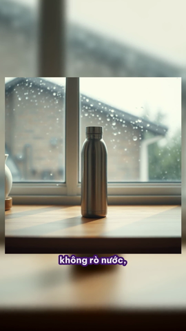 | 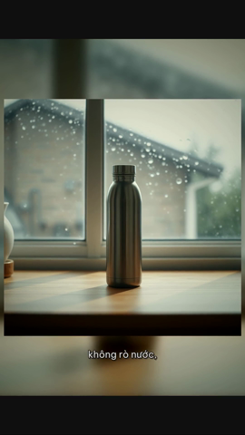 | 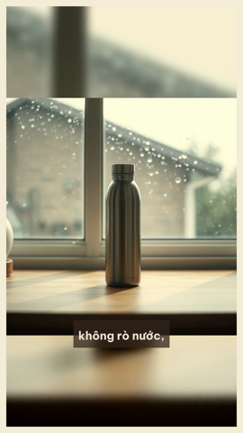 |
| 16:9 | 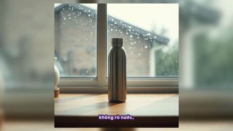 | 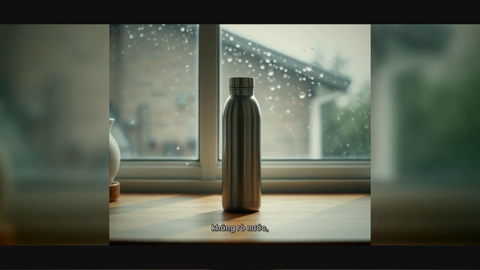 | 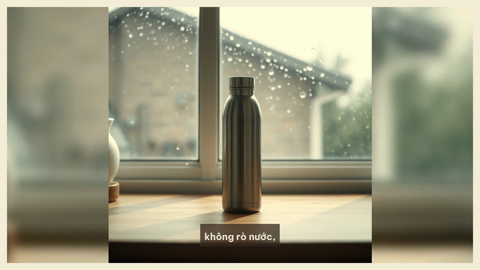 |

**Mốc 40–45 s, bộ fixture** (cảnh 9, ảnh mẫu tự tạo, câu thử dấu "Tiết kiệm 390.000đ — dùng thử…", cụm đầu):

| | Hoạt hình đồ họa | Điện ảnh tối giản | Cổ điển |
|---|---|---|---|
| 9:16 | 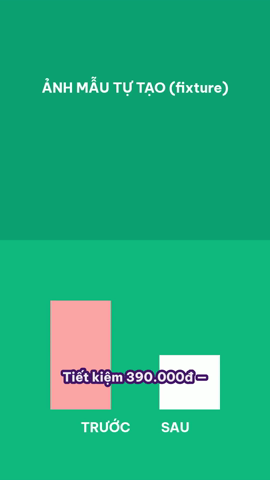 |  | 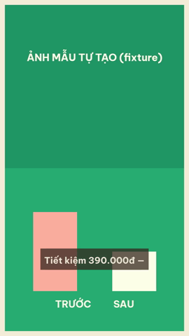 |
| 16:9 | 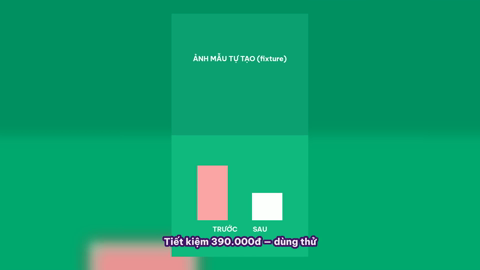 | 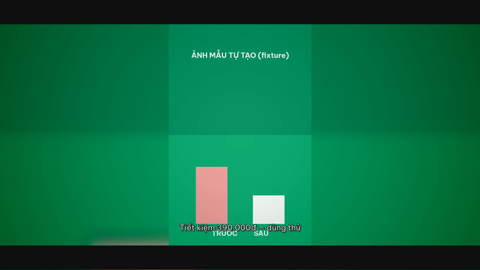 | 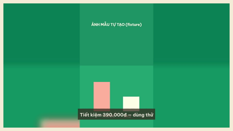 |

**Mốc cũ, bộ thật** (cảnh Demo, ảnh AI FLUX, câu "…không rò nước,"):

| | Hoạt hình đồ họa | Điện ảnh tối giản | Cổ điển |
|---|---|---|---|
| 9:16 | 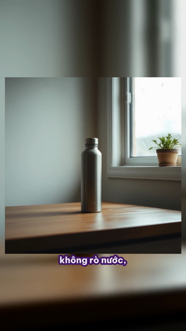 | 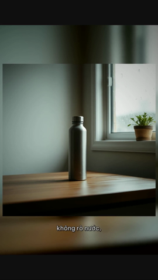 | 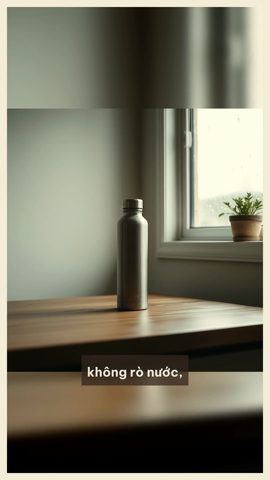 |
| 16:9 | 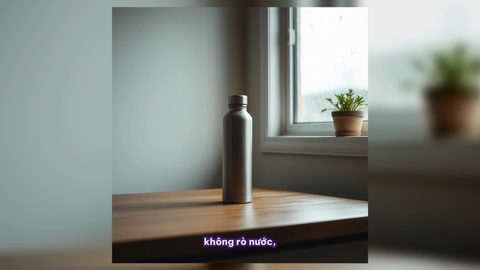 | 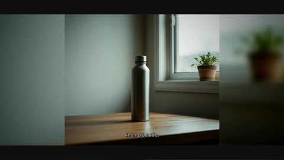 | 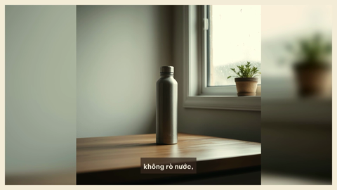 |

**Mốc cũ, bộ fixture** (cảnh Result, ảnh mẫu tự tạo; câu thử dấu **"Tiết kiệm 390.000đ — dùng thử miễn phí ngay hôm nay!"** hiện thành 3 cụm ở 9:16 ("Tiết kiệm 390.000đ —" / "dùng thử miễn phí" / "ngay hôm nay!") và 2 cụm ở 16:9 ("Tiết kiệm 390.000đ — dùng thử" / "miễn phí ngay hôm nay!"); khung chụp ở cụm đầu):

| | Hoạt hình đồ họa | Điện ảnh tối giản | Cổ điển |
|---|---|---|---|
| 9:16 | 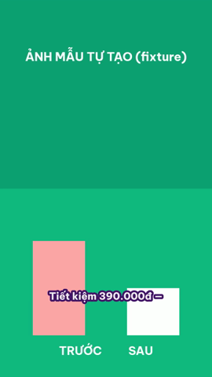 | 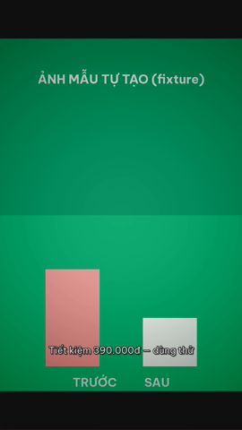 | 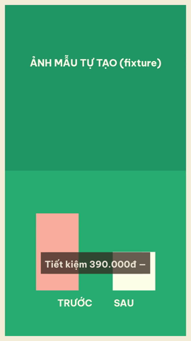 |
| 16:9 | 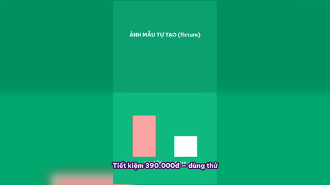 |  | 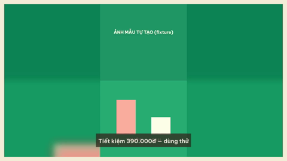 |

Khung 9:16 rộng 270 px, 16:9 rộng 480 px (để đọc được dấu).

## Đối chiếu render plan ↔ `script.v0`

Quyết định 15/10: **không ép render plan theo `script.v0`**. Contract kịch bản P1 (v1) làm sau, ở M2. Bảng dưới là điểm khớp/lệch để M2 dùng khi viết v1
(`docs/specs/contracts/script.v0.schema.json`; render plan: `render_plan.py`).

| `script.v0` | Render plan | Khớp? | Ghi chú |
|---|---|---|---|
| `schema_version` = `"0"` | — | Thiếu | Plan chưa có phiên bản |
| `product_id`, `knowledge_version` | — | Không cần | Renderer không dùng; M2 giữ để truy vết |
| `platform` (`tiktok`/`reels`/`shorts`) | — | Thiếu | Spike dùng một vùng an toàn chung cho phụ đề |
| `language` = `"en"` (const) | `language` = `"vi"` | **Lệch** | P1 cần tiếng Việt |
| `intent`, `format` | — | Không cần | Renderer không phân biệt |
| `target_duration_s` (15–60) | — | **Lệch** | Plan không khai báo; độ dài suy ra từ audio, ngoài khoảng của `config.py` (mặc định 40–45 s) thì báo lỗi |
| `aspect_ratio` = `"9:16"` (const) | tham số lúc dựng `--ratio 9:16\|16:9` | **Lệch** | Một plan dựng cả hai tỉ lệ |
| `hook` {`hook_id`,`text`,`type`,`angle`} | `scenes[0]` với `role: hook` | Gần | `hook.text` trùng lời đọc cảnh đầu; cần quy ước ai là nguồn |
| `scenes[]` (M2: 1–6 cảnh) | `scenes` (1–12 cảnh) | Khớp | Renderer nhận 1–12, chỉ chặn theo tổng thời lượng (đề xuất ở #83, làm trong PR này); M2 sinh 1–6 là nằm trong khoảng |
| `scenes[].index` | thứ tự trong mảng | Khớp | |
| `scenes[].role` (hook/problem/demo/result/proof/cta) | `role` (cùng 6 giá trị) | Khớp | |
| `scenes[].duration_s` | `min_duration_s` | **Khác nghĩa** | Kịch bản ước lượng; renderer lấy `max(min, đệm đầu + giọng + đệm cuối)` từ audio thật |
| `scenes[].voiceover` (văn bản) | `voice` (file audio) | **Khác loại** | Văn bản → audio do TTS làm trước khi dựng (ADR-0004) |
| `scenes[].on_screen_text` | `caption` | Khớp | Chia thành cụm ≤ 5 từ (9:16) / ≤ 8 từ (16:9) |
| `scenes[].visual.kind` (`screenshot`/`screen_recording`/`text_card`/`logo`) | `kind` (`image`/`video`/`text_card`) | **Lệch** | `screenshot`, `logo` → `image`; `screen_recording` → `video`; `text_card` giữ nguyên |
| `scenes[].visual.ref` | `asset` | **Khác loại** | `ref` có thể là mô tả shot chứ không phải đường dẫn; cần bước chọn/tải tư liệu trước khi dựng |
| `scenes[].claims[]`, `experience_claims` | — | Không cần | Kiểm duyệt ở M2/QA, không ảnh hưởng hình |
| `cta` {`text`,`uses_tracking_link`} | cảnh `role: cta` | Gần | Link tracking không hiện trong video |
| `disclosure` | — | Thiếu | Chưa hỗ trợ (cần cho `ai_avatar`, ngoài MVP) |
| — | `title`, `preset`, `music`, `source` | Thêm | Do renderer cần (preset, nhạc nền, ghi nguồn tư liệu) |

## Giới hạn và việc còn mở

Tách theo mức ảnh hưởng, để không kéo thêm phạm vi cho spike. Ngoài thay đổi mốc 40–45 s và số cảnh 1–12 (mục "Mốc thời lượng" ở trên), không mục nào dưới đây được sửa trong PR này.

### A. Ảnh hưởng đường chạy CPU hiện tại (libx264, mặc định)

1. **Chưa nghe 6 câu có giọng tổng hợp mới** (trạng thái: **chờ QA nghe**): câu "Bình giữ nhiệt Acme Demo…" (đổi thương hiệu, tổng hợp lại từ 15/10) và **5 câu mới** thêm cho mốc 40–45 s (`prepare_real.EXTRA_TEXT`, tổng hợp 20/10 bằng cùng mô hình/giọng VieNeu). 4 câu còn lại là bản VieNeu gốc (PR #73). ffprobe chỉ kiểm định dạng và thời lượng, không xác nhận được phát âm hay chất lượng nghe (số, "Acme Demo", "500ml", "1,2 kg" là chỗ dễ đọc sai). Kết quả nghe do QA ghi, spike không tự chấm. Bộ thật không commit (`local/`); QA chạy `resynth_voice.py` + `prepare_real.py` (mục "Chạy lại") hoặc xin file từ tác giả.
2. **Số cảnh 1–12** (`render_plan.MIN_SCENES/MAX_SCENES`): đã nới từ 3–12 trong PR này theo đề xuất ở #83, chỉ chặn theo tổng thời lượng. 12 là trần kỹ thuật chưa đo thêm (xem ghi chú bên dưới).
3. **Phụ đề chia thời gian theo số ký tự** trong câu (TTS chỉ cho mốc theo câu, ADR-0004), nên cụm có thể lệch vài trăm ms so với giọng.
4. **Cấu hình VieNeu chọn** là `vieneu-mai-anh-onnx-cpu` (ADR-0004 ưu tiên); các cấu hình khác chưa thử với renderer.
5. **Giới hạn 300 s mỗi lần chạy ffmpeg** (`renderer.RENDER_TIMEOUT_S`) áp dụng cho mọi encoder, kể cả CPU. Với video 40–45 s, số đo chậm nhất là **59,8 s** (cổ điển 16:9, máy tác giả, CPU), còn dư ~5 lần; ngoại suy sang máy chậm hơn 1,5–1,75 lần ~90–105 s (chưa đo). Máy yếu hơn nhiều, hoặc chạy nhiều video song song trên một máy, có thể chạm 300 s và cần nâng ngưỡng hoặc tính theo độ dài video (chưa làm, ngoài phạm vi spike). Ngưỡng này **chưa phải tiêu chí hiệu năng đã chốt** (lead, 19/10); xử lý quá hạn trên worker (hàng đợi, thử lại) cũng chưa làm.

### B. Chỉ cần xử lý khi mở rộng hoặc đóng gói

6. **NVENC/QSV** (chỉ để đo, không phải đường mặc định):
   - NVENC treo sau lỗi mã hoá (known issue): một lần trong ma trận thật, `h264_nvenc` (co-dien 16:9) báo `Error submitting video frame to the encoder` rồi tiến trình ffmpeg không thoát, chiếm CPU hơn 10 phút cho đến khi bị dừng. Đo lại cùng cấu hình thì chạy ổn (25,8 s). Chưa rõ nguyên nhân (driver/GPU laptop). Timeout 300 s ở mục 5 biến treo thành lỗi. Đường CPU không bị.
   - NVENC/QSV mới đo trên 1 máy; Tài chưa chạy.
7. **Linux/CI/máy chủ không GPU**: chưa thử. Số đo chỉ trên Windows (tác giả và Tài). Chỉ thử với FFmpeg 8.0 Gyan full build.
8. **Giấy phép FFmpeg (bản GPL → LGPL)**: gọi qua `subprocess`, không phân phối. Nếu đóng gói thì dùng build LGPL, và build đó không có libx264 nên phải chọn encoder H.264 khác (chưa kiểm). Chi tiết ở ADR-0003 §Giấy phép FFmpeg.
9. **Revideo không đo** (quyết định 15/10): Chrome/Puppeteer trên máy dev crash khi mở (mã `0x80000003`) với mọi biến thể thử (kể cả `--single-process`). Lý do và rủi ro Node/Chromium ghi trong ADR-0003.

### Ghi chú: số cảnh (đã làm trong PR này, 20/10)

Ràng buộc 3–12 cảnh là của spike, không phải của sản phẩm. Theo đề xuất của M1 trên PR #83 (điểm 3.1), renderer nay nhận **1–12 cảnh** và chỉ chặn theo **tổng thời lượng** (`config.py`); M2 giữ 3–6 cảnh làm khuyến nghị và cho 1–6, nên không còn cảnh nào của M2 bị renderer từ chối vì số cảnh. Đây vẫn là đề xuất chờ nhóm thống nhất chính thức (chưa phải quyết định); thay đổi nhỏ và có thể gỡ lại.
- **Lỗi đã sửa kèm theo**: plan 1 cảnh làm ffmpeg báo thiếu nhãn `[vjoin]` (vòng `xfade` rỗng); nay tự nối `[v0]` → `[vjoin]`. Có test cả ở mức chuỗi lệnh lẫn dựng thật.
- **Bỏ trần 25 s ở `min_duration_s`** của từng cảnh (hằng số còn sót từ mốc cũ), nếu không thì plan 1 cảnh 40 s không viết được.
- **Phạm vi đã kiểm**: 1 cảnh (42 s) và 12 cảnh (42,3 s) dựng thật bằng thẻ chữ trong test (16:9, preset cổ điển); ma trận đo bên dưới chỉ có plan **10 cảnh**. 13 cảnh trở lên bị từ chối ở bước kiểm schema. Chưa đo thời gian/RAM của 12 cảnh toàn ảnh.
- 1 cảnh 40–45 s nghĩa là một câu thoại (hoặc `min_duration_s`) dài ngần đó, đó là chuyện của kịch bản M2 chứ không phải của renderer.

### Việc tổ chức (không phải giới hạn kỹ thuật)

- **Ai nhận tích hợp renderer** vào worker/job/Storage: chưa có (chờ BE; Thông và Tài đang trao đổi cách chia). Chưa có lớp adapter theo ADR-0005.
- **Contract kịch bản**: không ép render plan theo `script.v0`; contract kịch bản P1 (v1) làm sau, ở M2 (PR #83). Xem bảng đối chiếu ở trên.
- **Decision log**: chưa thêm dòng vào `docs/logs/decision-log.md` (quyết định 15/10); thêm khi ADR-0003 chuyển sang Accepted.

## Nguồn font và giấy phép

Be Vietnam Pro (SIL Open Font License 1.1, `fonts/OFL.txt`), tải từ
https://github.com/google/fonts/tree/main/ofl/bevietnampro (bản raw: `https://raw.githubusercontent.com/google/fonts/main/ofl/bevietnampro/`).
Có đủ dấu tiếng Việt; không commit font nào khác. Ba file Regular/Bold/ExtraBold nặng ~410 KB.
